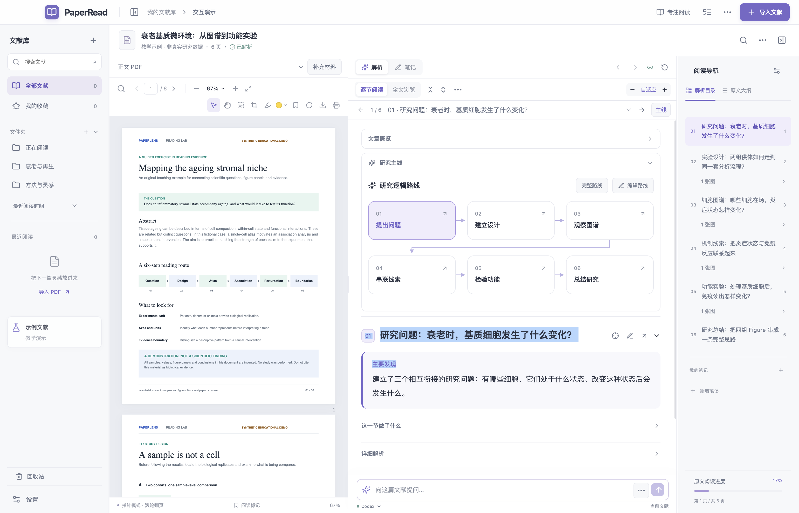
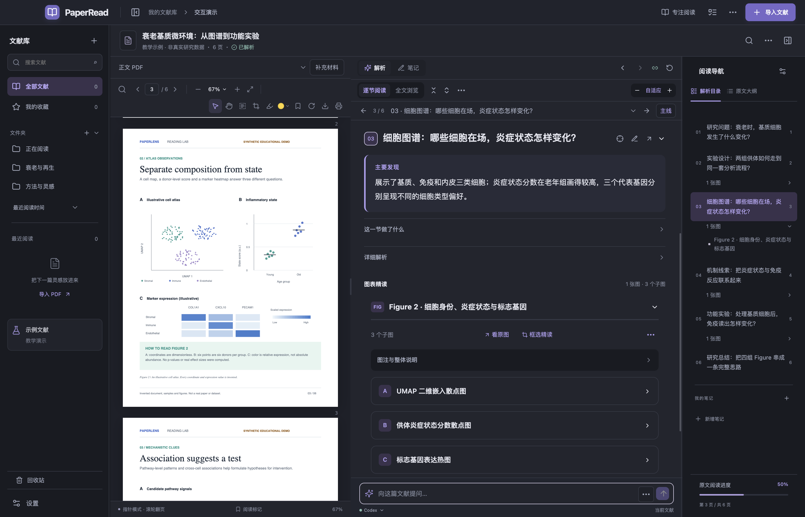
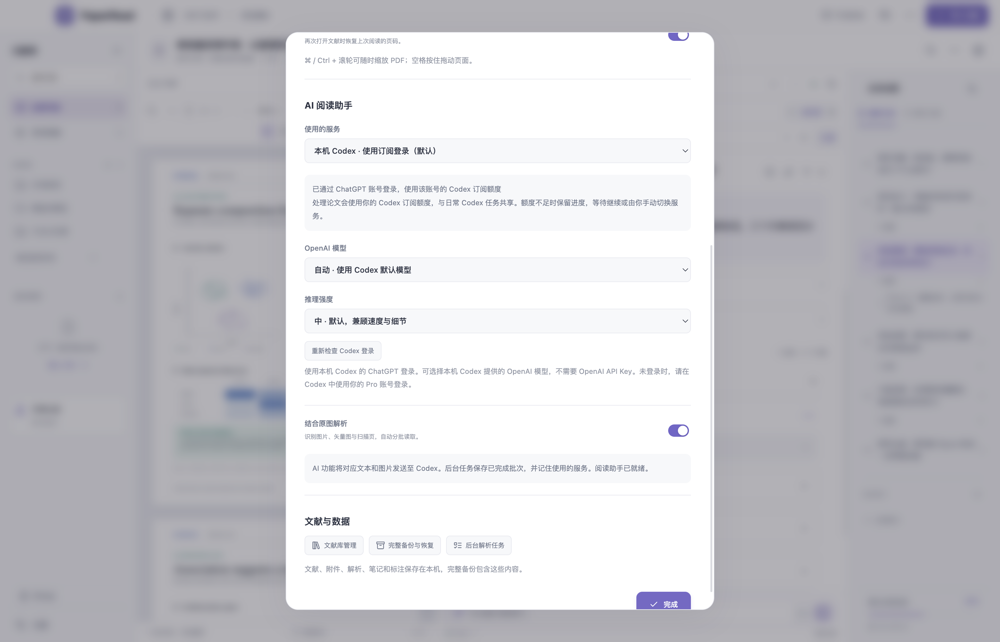
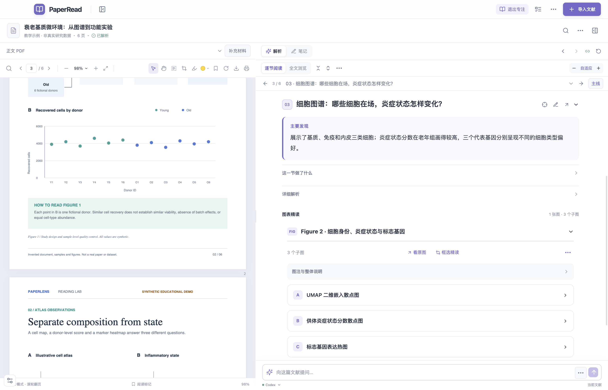

# PaperRead 0.7.0

医学文献深度阅读工作台 · macOS Apple Silicon · v0.7.0

默认连接本机 Codex，通过 ChatGPT 订阅登录使用；也可手动切换 DeepSeek。支持基础医学、生信分析、纳米材料、临床研究、综述 / Meta 五类文献。

## 界面预览

截图均使用内置虚构教学文献，不包含个人文献库、笔记、标注或密钥。

**三栏阅读与可编辑研究主线**



**深色模式与逐图精读**



**本机 Codex、OpenAI 模型与推理强度设置**



可用模型以当前本机 Codex 账号返回的列表为准；推理强度可选低、中、高。

当前 Mac 安装包见 [v0.7.0 私有发布](https://github.com/Charterhale/PaperRead/releases/tag/v0.7.0)。


面向基础医学、生信分析、纳米材料、临床研究和综述 / Meta 的本地文献阅读工作台。左侧读 PDF，中间读解析与笔记，右侧用原文目录或解析目录联动定位。支持可编辑的研究逻辑图、逐子图精读、后台解析、文献库整理和完整备份。

界面采用适合 macOS 的圆角、半透明层次和明暗主题；桌面版通过 Electron 运行。

## 0.7.0 阅读布局

- 顶部保留导入、任务和专注阅读，文献管理、备份及明暗主题收进「工作台工具」。标题栏显示类别与页数，完整文件名和书目信息保留在文献资料中。
- 原文、解析、目录分区对齐；「专注阅读」暂时收起文献库和右侧导航，退出后恢复原有宽度，设置仍在左下角。
- 解析先呈现主要发现；研究概述、详细正文、图注和子图解释按需展开。超过 220 字的说明显示短预览，可以展开全文，无需在小文本框内滚动。正文源数据、编辑、导出和备份仍完整保留；一键展开也会展开长文预览。
- 目录默认只展开当前章节的图表，其他章节可手动展开。章节和图表长标题最多显示两行，悬停可查看完整名称。子图默认收起，已有显式折叠状态继续沿用。
- PDF 搜索与工具栏合并，移除重复标题。修复短 PDF 在较高阅读区跳到末页后页码回退的问题。
- 每次更新都同步源码、演示截图、安装包及校验文件至同一私有仓库，并核对私有状态；不上传个人阅读资料。

**专注阅读**



## 0.6.1 Codex 订阅接入

软件名称统一为 PaperRead。更名继续沿用 `~/Library/Application Support/PaperLens`、原有文献库和备份格式，无需迁移已有文献。

- 默认调用本机官方 Codex CLI，沿用 ChatGPT 订阅登录。请先安装 Codex，并使用自己的 Pro 账号登录；设置页可重新检查登录状态。软件不会读取或导出 OAuth 凭证。
- 设置中可选择本机 Codex 提供的 OpenAI 模型，并设置低、中、高推理强度（默认中）。模型列表可重新检查，模型支持的强度以返回能力为准。高推理通常更耗时、耗额度；模型及强度选择会随设置保存。
- 文字解析、分批读图、扫描页、子图精读、文献问答和三部分翻译均可使用 Codex。解析结果沿用已有文档格式，原有笔记、标注、编辑、定位、折叠和备份保持兼容。
- 订阅额度与日常 Codex 工作共享。本入口排除 API Key 登录；额度不足或连接失败时提示并保留进度，由用户决定何时继续或手动选择 DeepSeek。
- DeepSeek 仍可在「设置 → AI 阅读助手 → 使用的服务」中手动选择。密钥只在当前窗口内存中保留，切换回 Codex 时不会发送该密钥。
- 后台任务记住创建时的服务和模型，继续时不混用不同模型的已完成片段。旧版 DeepSeek 任务需要手动切回 DeepSeek 才能继续；新 Codex 任务使用订阅登录。
- 使用本地临时文件向 Codex 附加页面图片，任务结束后清理；采用只读沙箱并关闭阅读任务不需要的工具、插件和多代理能力。原始文献与生成结果仍存于本机，AI 所需材料由 Codex 发送至其模型服务。
- 当前是个人 Mac 本地接入，依赖已安装的官方 Codex（已实测 CLI 0.147.0）。面向公众或商业托管发布时需另行采用官方支持的登录和服务方案。

## 0.5.0 阅读与资料保护

- **固定看图**：Figure 工具栏点击「固定看图」，或在子图内点击「固定对照」。左侧可同时保留两张图，各自拖动、滚轮缩放、复位；中间解析照常阅读和折叠。有已保存裁图时直接显示子图，否则明确显示原文整页。点击「返回 PDF」切回原文，固定图可再打开；切换文献时清空本次固定图。
- **精准定位**：搜索原文和高亮会短暂标出对应位置；已保存的裁图可直达其范围。小节标题旁的准星、Figure 工具栏的「校准定位」支持在 PDF 上框选段落或图片，之后目录跳转使用保存的位置。找不到文字时仍定位到页面并提示，扫描页可用框选校准。
- **统一搜索**：文献标题栏的放大镜或 `⌘K` 打开搜索，支持当前文献 / 整库范围以及原文、解析、子图、笔记、高亮批注筛选。显示命中片段，点击自动展开对应内容并定位正文或补充 PDF。扫描页没有文字层时，原文像素不参与文字搜索，但已生成的解析可以搜索。
- **回收站**：文献删除改为移入左侧回收站，PDF、附件、裁图、解析、笔记和标注均保留；可随时恢复，不自动清空。永久删除须再次确认。已有备份仍保留删除前内容。
- **每日自动备份**：「备份与恢复」中默认开启，应用运行时每天保存一份；错过的备份在下次打开后补做。默认保留最近 7 份，可选 3 / 7 / 14 / 30 份，提供立即备份和预览恢复。桌面版写入 `~/Library/Application Support/PaperLens/Automatic Backups`，先校验再轮换；只轮换这一目录中由程序生成的自动备份，手动导出的文件不受影响。备份包含回收站和任务检查点，不包含 API 密钥。失败状态和最近成功时间在备份窗口显示，失败后每小时重试。

## 打开与开始阅读

Mac 应用位于 `release/PaperRead-darwin-arm64/PaperRead.app`，双击启动，不需要安装 Node.js。当前打包目标为 Apple Silicon。应用使用本机临时签名，未经过 Apple 开发者公证。

1. 首次可查看内置教学文献，熟悉 PDF、解析和目录的联动。演示 PDF、图表和研究数据均为明确标注的虚构示例。
2. 点击「导入文献」，或将一篇 / 多篇 PDF 拖入窗口；也可按 `⌘O`。单篇 PDF 最大 150 MB。
3. 选择文献类型，默认使用本机 Codex 的 ChatGPT 订阅登录；无需 OpenAI API Key。可在设置中手动切换 DeepSeek 后填写其 API Key。
4. 在任务列表查看进度；解析时可以继续阅读、整理其他文献。
5. 点击逻辑节点、右侧章节或 Figure 目录，联动定位 PDF 和对应解析。

原文目录优先采用 PDF 书签，没有书签时使用识别到的标题或物理页码。右侧解析目录可以调整顺序、隐藏条目；导航设置不会改变原始 PDF。

0.2.1 修复了连续滚轮缩放时的画面闪动和位置漂移：缩放中保留当前图像，停滚后更新清晰画面；连续输入按帧合并，鼠标下的原图位置保持稳定。

## PDF 看图与标注

| 操作 | 使用方法 |
| --- | --- |
| 指针翻页 | 默认使用鼠标指针工具，滚轮上下翻页；按住 ⌘ / Ctrl 滚轮可主动缩放 |
| 拖动平移 | 点击手形工具，按住鼠标左键拖动，可上下及左右移动放大后的页面 |
| 滚轮缩放 | 在手形模式滚动鼠标滚轮，围绕指针所在位置缩放；支持触控板缩放手势，范围为 20%–500% |
| 临时平移 | 在文字模式中按住空格，再拖动鼠标；松开后继续选择文字 |
| 选择文字 | 点击文字选择工具，再拖选 PDF 文字，可调用翻译、提问或摘录 |
| 高亮 | 开启高亮工具，选择文字；颜色按钮提供五种预设及自选颜色 |
| 修改已有高亮颜色 | 打开底部「阅读标记」，使用对应标注旁的颜色选择器 |
| 恢复适宽 | 点击缩放百分比或适应宽度图标 |
| 上下翻阅 | 拖动页面、使用滚动条，或使用页码、上一页 / 下一页按钮 |

0.3.3 为工具栏增加可见的悬停提示，说明按钮名称与具体用法；当前操作模式会保留到下次打开。文字选择模式同样使用滚轮上下翻页。

还支持全文搜索、页面旋转、页书签、删除标注、下载和打印。PDF 的阅读标记保存在本机，下载功能保留原 PDF 文件内容，不会将标记写入原文。旧版黄色高亮可以继续读取。

划词翻译包含中文译文、专业术语和语境解释。扫描 PDF 没有文字层时，不能直接划词；当前版本没有自动 OCR。

## 解析阅读与自适应缩放

默认使用「逐节阅读」，一次显示一个小节；用上一节、下一节或小节选择器连续阅读。点击「全文浏览」可恢复全部章节连续展示。右侧目录、逻辑节点、图表跳转继续同时定位解析与 PDF，返回与前进会恢复阅读方式和位置。

每节先展示「这一节做了什么」与「主要结果」，完整正文放在「详细解析」中。文章概览、研究主线和图注也可展开；顶部「主线」按钮可随时回看逻辑图。子图先展示研究问题与结论，再分别展开「怎么读这张图」「实验与结果细节」「完整讲解」，坐标、分组、方法、结果、统计与补充解释均完整保留。

章节、Figure、子图及内部详细说明均可折叠。工具栏的一键折叠 / 展开作用于当前阅读范围：逐节模式是当前节，全文模式是全部章节。各层折叠状态分别保存在文献中并纳入完整备份；更换展示方式不会修改原始解析、笔记、高亮或 Markdown 导出。

正文不再重复展示模板式“证据边界”段落，也不在每段后堆叠 PDF 位置。定位入口集中在目录和跳转图标，仍保留章节与图片的关联页码。旧解析中的部分模板文字在阅读界面隐藏，编辑源文仍保留。

解析栏默认按照可用宽度换行，正文采用 14px 字号与舒展行距；缩窄中间栏不会自动缩小文字。工具栏的 `− / +` 可以独立调整解析缩放，范围为 70%–160%；点击「自适应」恢复自动模式。该设置也适用于笔记阅读。PDF 缩放与解析缩放彼此独立。

逻辑路线使用可换行的圆角节点，长标题会在节点内换行；连线随布局调整，不再把所有节点挤在一条横向长条中。拖动各栏之间的分隔线可以调整宽度，PDF、解析与导航分别滚动。

## 子图精读

在 Figure 的「框选精读」、尚未保存裁图的子图「子图精读」，或 PDF 工具栏的裁图按钮中进入框选模式。已有裁图的子图会直接打开精读窗口。在 PDF 上拖出矩形，将子图、坐标轴和需要的图例一起框入；松开鼠标后得到高分辨率裁图。按 `Esc` 可取消框选。

裁图从 PDF 原页面重新渲染，使用原始坐标保存，不是放大截图；旋转页面后框选也会还原到原始方向。子图图片可与解析一起保存，完整备份也会带走这些裁图。

0.3.2 的子图精读默认以阅读模式显示现有解析，正文、列表和表格完整展开并自动换行；每一项可单独折叠，也可全部展开 / 折叠。切换到「编辑」后，输入框按全文自动增高，无需在每个小输入框里来回滚动。裁图和精读正文各自滚动，底部保存按钮保持可见。

每个子图按下列字段拆解，可手动补充或纠正：

1. **图形类型**：如 UMAP、热图、流式门控图、Western blot、显微图、森林图等。
2. **研究问题**：为什么做这项实验，这张小图具体回答什么。
3. **实验 / 分析方法**：方法测量什么，使用的材料、处理与时间点。
4. **分组、颜色与图例**：各组是谁，对照是什么，点、线、颜色、符号分别代表什么。
5. **X 轴与 Y 轴**：变量、单位、刻度或降维维度；无坐标图按实际内容解释。
6. **读图步骤**：从哪里开始看，如何比较各组，如何理解比例尺、误差线和归一化。
7. **具体结果**：主要比较、变化方向和原文提供的关键数值。
8. **样本量与统计**：每个点的含义、生物学样本量、统计检验和显著性标记。
9. **子图结论**：这幅图说明了什么，以及它在整篇研究中的作用。

「逐图细读」可结合整页图片重新解释 Figure；针对密集小字或特定子图，优先使用框选精读。没有提供或无法辨认的信息会简短标记，不会补造坐标和数值。

## 编辑正文、逻辑路线与历史版本

- 文章概览旁的编辑按钮：修改解析标题与概览。
- 每节标题旁的编辑按钮：修改标题、逻辑简称、总体概括、主要结果、Markdown 正文和关联 PDF 页。
- 子图的「编辑解析」：逐项修改子图编号、图形类型、坐标和详细解读。
- 「编辑路线」：修改节点标题、关联小节、顺序，添加 / 删除节点，编辑连线的起点、终点和关系说明；也可以按章节重新生成。
- 「编辑历史与恢复」：保留最近 12 次修改前的解析版本。恢复一个历史版本时，也会先保留当前版本。
- 「我的笔记」：独立的 Markdown 编辑与预览，输入后自动保存。

后台新解析完成时，已人工编辑的正文会保留，新结果可在任务列表中选择「应用此解析」。应用前也会保存旧版。

文献栏的导出功能可以保存解析和笔记为 Markdown。Markdown 导出与完整文献库备份是两个入口；迁移 PDF、聊天、裁图和历史版本时请使用完整备份。

## 五类文献专用证据表

在解析工具栏打开「专用证据表」。生成的研究要素和相应类别模板会在表中呈现，可以修改字段及内容、增删行，并导出 CSV。

| 类型 | 主要字段 |
| --- | --- |
| 基础医学 | 研究问题、模型、分组对照、干预剂量与时间、生物学重复、检测指标、关键结果、机制与救援实验 |
| 生信分析 | 数据集编号、样本与供者、分组、预处理、批次、分析流程、阈值与多重检验、训练 / 验证、代码 |
| 纳米材料 | 组成与制备、粒径 / PDI / 电位、形貌结构、载药、释放、靶向与分布、剂量效果、安全性 |
| 临床研究 | 研究设计与注册、人群及纳排、样本量、干预对照、终点与随访、效应量及置信区间、缺失值、不良事件 |
| 综述 / Meta | 综述类型、检索库与日期、纳排、纳入研究、主题 / 合并结局、模型、异质性、亚组及敏感性、质量评价 |

叙述性综述不会强行生成不存在的合并效应；未提取到的模板字段可以直接填写。

## 文献库管理

「文献库管理」提供表格视图，可编辑标题、作者、期刊、年份、DOI、PMID、类别、标签、分区、收藏及未读 / 在读 / 已读状态。

- 搜索覆盖文献资料、标签、PDF 提取全文、笔记和解析概览。
- 按分区、文献类型、阅读状态筛选；按导入时间、年份或标题排序。
- 批量选择文献，移动分区、添加标签、加入解析队列或删除本机记录。
- 新导入 PDF 与已存文件指纹完全相同时会跳过；库中其他按文件指纹或 DOI 识别的可能重复条目会标记，供人工处理。
- 左侧文献库可隐藏；支持新建文件夹 / 分区及移动文献。

作者等书目信息可人工补充，当前没有外部 DOI 元数据查询、Zotero 双向同步或云账户同步。

## 后台解析与继续任务

PDF 先逐页检查实际位图、矢量绘图、扫描图像及可见图形批注。带 OCR 的扫描页仍发送原图；正文里只引用 Figure 不会因此被判成含图页。检测失败或文字不足以确认的页会保守发送整页原图。任务列表显示准备页面、等待、运行、暂停、完成、失败或取消状态，以及当前进度。单篇可提交解析，也可从文献库批量加入队列；同篇文献不会同时重复排队。

0.3.0 取消整篇文献 24 张原图的中断限制。页面图片按最多 4 页、8 MiB 一批准备与保存；AI 请求按最多 6 张图、12 MiB 与 4 万文字分批处理。所有计划中的原图备齐后才开始 AI 解析，缺页或读取失败会指出具体问题，已保存的原图保留供继续。当前支持单篇最多 160 页，文字总量 80 万字符。

文字、图片和空文字扫描页都会进入批次，已完成的批次会保存在本机。失败或取消后可重试，复用已保存的片段；正在处理但尚未完成的片段需要重新请求。0.3.1 兼容模型把子图说明返回为列表、对象或空值：已有详细字段时不再强制重复一段解读。没有任何可读解读的子图会单独发起一次格式修复，保留其余小节、图片与已有有效字段；修复仍失败时保留检查点供继续，不发布不完整结果。

各批的小节、Figure 和子图解析在合并时完整保留；超长汇总材料会再分层整合总览。进度到 100% 表示完整结果已保存。解析工具栏的「处理记录」可核对每页使用文字还是原图、以及所属批次。此记录证明页面已进入处理，具体图形解读仍取决于模型输出和图像清晰度。

**后台执行需要本机服务继续运行。** 切换文章、最小化窗口或在服务仍运行时刷新阅读界面，不会取消已提交任务。完全退出应用、停止本地服务或重启电脑后，解析中的未完成任务显示为暂停，尚未备齐原图的任务显示为等待继续；下次启动后重新填写 Key，再在任务列表中继续。它不是应用退出后仍运行的系统常驻服务。

完整备份包含任务记录、解析输入和已完成片段的检查点。恢复到其他电脑后，未完成任务会以暂停状态导入；配置 Key 后点击「继续 / 重试」，可以复用这些片段。恢复不会自动发起新的 DeepSeek 请求，也不会带入 API Key。

## 完整备份与恢复

打开「备份与恢复」，点击「下载完整备份」。通常生成 `.paperlens.gz` 压缩文件；不支持压缩的环境会导出 `.paperlens.json`。

备份内容包括：

- 原始 PDF、提取文本、文献资料与标签。
- 解析、子图裁图、专用证据表与逻辑路线。
- Markdown 笔记、聊天、最近修订版本。
- 高亮及颜色、书签、分区、阅读位置与界面偏好。
- 后台任务、任务输入与已完成片段检查点。

恢复时先选择文件，预览文献数、PDF 数、标注和聊天数量。默认保留本机已有编号的记录，只添加新文献；也可选择用备份替换相同编号的记录，其余文献保留。默认在恢复前下载一份当前文献库备份。

后台任务按所选冲突策略一同恢复；如果任务恢复失败，界面会说明原因，已恢复的文献仍可保留，并可重试任务恢复。

恢复会检查格式及 PDF 完整性。最大支持 1 GB 的备份文件，解压后的内容也不能超过 1 GB；API Key 不写入备份。备份文件包含自己的文献与阅读内容，应存放在自己选择的位置。

原始 PDF、文献和解析保存在 IndexedDB，标注及界面设置保存在 localStorage。浏览器开发版、浏览器生产版和 Electron 桌面版是不同的存储空间，可以通过备份迁移。清除站点数据、删除应用数据或换电脑之前，请先导出备份。

## DeepSeek 配置与数据去向

从 [DeepSeek 平台](https://platform.deepseek.com/api_keys) 获取 API Key，在软件设置中填写。密钥仅保存在当前窗口内存及运行任务所需的服务内存中，不写入文献、任务文件或备份。刷新 / 关闭窗口后，界面需要重新填写 Key；已经提交的任务可在服务继续运行时使用已有凭据完成。

也可在启动服务前配置 `DEEPSEEK_API_KEY` 环境变量。模型和显示偏好保存在本机，密钥不随偏好保存。

后端固定请求 DeepSeek 官方 `https://api.deepseek.com/chat/completions` 接口。触发 AI 解析、提问、翻译或拆图时，相关正文、问题及所选图片会提交至 DeepSeek；本地 PDF 阅读、标注、正文编辑、文献管理和备份不需要发送文献至 AI 服务。

代码提供 `deepseek-flash` 和 `deepseek-v4-pro` 选项，图片解析使用 `deepseek-flash`。模型可用性、视觉权限和费用以账户实际接口返回为准。关闭「结合原图解析」可处理确认没有图形的纯文字 PDF；若检测到图像、扫描或待确认页面，会提示开启原图解析，避免静默遗漏页面内容。明确选择子图精读时会使用裁图。

真实 DeepSeek 账户和具体论文识别质量需要配置 Key 后验证。开发测试中的模拟响应仅验证程序流程，不代表真实文献解析准确率。

## 当前范围

本版的 PDF 联动以物理页码为基础，并为手动裁图保存区域坐标；尚未自动标出原句。子图框选由读者操作，暂不自动检测 A / B / C 的边界。未实现扫描版 OCR、补充材料自动关联、多篇证据合并或云同步。

## 本地启动与打包

需要 Node.js 22.12 或更新的受支持版本，以及 npm。

```sh
cd PaperRead
npm install
npm run dev
```

开发界面为 `http://127.0.0.1:5178`，本地 API 随命令启动。

```sh
npm run build
npm run desktop
```

也可在构建后使用 `npm start` 运行生产网页版本。桌面版固定使用 `127.0.0.1:41829`，避免端口变化导致文献库存储来源改变；端口已被占用时会显示错误。

```sh
npm test
npm run build
npm run package:mac
```

打包产物在 `release/PaperRead-darwin-arm64/`。Intel Mac 需要调整架构并在对应设备验证；打包流程不包含 Apple 开发者签名、公证或自动更新。

PDF 新交互专项测试：

```sh
# 本地开发界面启动后运行，测试使用系统安装的 Microsoft Edge
node tests/pdf-v2-smoke.mjs
TEST_URL=http://127.0.0.1:5178 node tests/pdf-smoke.mjs
```

新交互测试覆盖指针中心缩放、双轴拖动、空格平移、颜色保存与改色、划词、高清裁图、旋转裁图和取消；原有专项测试覆盖搜索、跳页、缩放旋转、书签 / 高亮和原 PDF 下载一致性。

## 工程结构

```text
src/components/       PDF、解析、逻辑路线、文献库与备份界面
src/lib/              PDF 提取、Markdown、版本编辑与本地保存
server/               本机 API、DeepSeek 请求、后台任务与分块检查点
electron/main.cjs     桌面窗口与本地服务
public/demo.pdf       六页虚构教学文献
scripts/              PDF 示例、资源准备和桌面打包
tests/                接口、任务、文献库及浏览器交互测试
```

Electron 开启沙盒与上下文隔离，关闭渲染进程 Node.js 访问；本机 API 仅绑定回环地址。原始 PDF 不会因为编辑解析、逻辑路线或高亮而被改写。


## 0.4.0 阅读与文献空间

- 标题栏的“期刊官网”使用 DOI 跳转到出版方，也可手动填写 HTTPS 官网链接。
- 文献空间支持最近阅读、名称、导入时间排序；悬停文献或分区可重命名。设置在左下方。
- 逻辑图默认显示简洁主线，细节与补充章节可展开；完整路线及原有节点、连接均保留，可在编辑器选择主线节点。
- 解析栏顶部支持返回与前进，恢复 PDF 缩放、平移和正文阅读位置。
- PDF 的“阅读标记 → 高亮与评论”支持分类、评论，以及追加到笔记；来源链接可直接定位原页。原高亮坐标、颜色保留。
- PDF 上方“补充材料”可关联附件并设置图页映射；正文中的 Supplementary Figure / Fig. S / Extended Data 编号可点击打开对应 PDF 页。自动检测到的编号需核对后保存。
- 完整备份包含补充 PDF、图页映射、官网链接、分类评论与阅读偏好，兼容此前版本备份。
- 设置集中管理主题、鼠标模式、解析大小、记住页码、DeepSeek 与数据工具。
